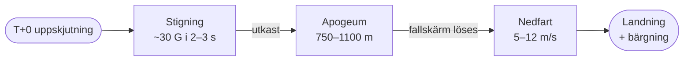

# CanSat — allt man borde veta (nybörjaröversikt)

*Sammanställd 2026-11-03. Syfte: en kompakt, nybörjarvänlig introduktion till vad en
CanSat är och allt ett nytt lag bör veta innan de börjar bygga. Bygger på fakta i
[arkiv/CLOUD-CHAMBER.md](../arkiv/CLOUD-CHAMBER.md) och denna fil.*

---

## 1. Vad är en CanSat?

**CanSat = en "satellit" i storleken av en läskburk** (eng. *Cansat* av "Can" + "Sat").
Den skjuts upp ~1 km med raket, släpps ut, faller med fallskärm och gör en mätuppdrag
under nedfärden. Målet är att bygga en komplett, fungerande minisatellit med ellenktronik,
sensorer, strömförsörjning och radiokommunikation — i verklig "satellit-stil".

**Tre saker man alltid ska komma ihåg:**
1. Den är **inte i omloppsbana** — den faller rakt ner från ~1 km höjd.
2. Hela uppdraget är **väldigt kort**: ~70–120 sekunder från apogeum till marken.
3. Det **måste gå att hitta och återfinna** den efter landning (GPS/blipp).

Tävlingen: [Suomen CanSat -kilpailu i Vasa 11–14.3.2027](https://www.esero.fi/cansat-kilpailu),
driven av [ESERO Finland](https://www.esero.fi) (i samarbete med ESA).

---

## 2. Hur en CanSat-flygning går till (flygprofilen)

- **Apogeum (högsta höjd):** 750 m (2026, H219-motor) till 900–1100 m (2024–25).
- **Nedfartshastighet:** måste ligga i **5–12 m/s** (obligatoriskt säkerhetskrav),
  rekommenderat 8–11 m/s. Varken snabbare eller långsammare är tillåtet.
- **Mättid:** med 8–11 m/s och 750–1100 m höjd → ~68–137 s av data. Designa allt runt
  att datainsamlingen är *kort och tät*.
- **G-belastning:** kravet är "klara 20 G", men uppmätt verklig acceleration i Vasa har
  varit **~30 G** med snabbbrinnande motorer. Bygg för minst 30 G.
- **Vädret/materialet:** tävlingen är i mars i Vasa → kallt (0–10 °C), snö/markreflexion.
  Räkna med temperatur- och markstörning.

---

## 3. Hårda krav man måste uppfylla (CanSat Finland / ESERO Finland)

Källa: [esero.fi – Kilpailun vaatimukset](https://www.esero.fi/cansat-kilpailun-vaatimukset)
och [finska guiden](https://www.esero.fi/finnish-cansat-competition-guidelines).

| Krav | Värde | Varför/Så påverkar det oss |
|---|---|---|
| **Volym** | Europeisk läskburk: **115 mm hög, 66 mm Ø** | All elektronik, batteri, antenn och ev. sekundärmission måste rymmas i ~330 ml |
| **Massa** | **300–350 g** totalt (inkl. batteri) | Snäv budget — varje gram räknas |
| **Budget** | **≤ 500 €** | Rymmer färdiga moduler och sensorer |
| **Fallskärmsfäste** | tål **≥ 50 N** (ESA rek. 200 N) | Mekaniskt testkrav |
| **4,5 cm-locket** | **4,5 cm axialt** utrymme i raketen ovanför burken | Fallskärm + fäste + antenner måste rymmas i locket |
| **Ström** | Systemen ska klara **2 h på sträck** (ESA int. 4 h) | Batteri + effektbudget |
| **Acceleration** | Klara **20 G** (verklig ~30 G) | Mekanisk robusthet |
| **Förbjudet** | "Räjähteet, sytyttimet, pyroteknik, palonarat materiaalit, farliga ämnen, biologiska nyttolaster" | Brandfarliga ämnen (t.ex. alkohol) kräver **skriftligt specialtillstånd** |
| **Återfinnbarhet** | GPS/blipp så det går att hitta | Obligatoriskt |
| **Strömbrytare** | Lättåtkomlig batteri- och huvudströmbrytare | Säkerhetskrav |

**Poängviktning:** teknik 35 %, vetenskapligt värde 30 %, "professionella kompetenser" 25 %,
outreach 10 %. Sekundärmissionens utförande räknas in under teknikposten.

---

## 4. Tidslinje och deadline (2026–2027)

| Datum | Milstolpe |
|---|---|
| 10.9–30.10.2026 | Förregistrering (⚠️ 2026-11-03 är det osäker/efter om laget hann med — verifiera med ESERO!) |
| 11.12.2026 | Projektrepresentation + videopitch |
| 21.12.2026 | Urval meddelat |
| 20.2.2027 | **Obligatorisk Pre-Launch Report (PLR): max 15 sidor, engelska** → esero.finland@heureka.fi |
| 11–14.3.2027 | Tävling i Vasa |

⚠️ **Kolla genast med ESERO Finland att laget är registrerat** — förregistreringen
stängde 30.10.2026. Sista möjliga anmälan är projektrepresentationen 11.12.2026.

---

## 5. Vad man måste bygga (moduler)

En CanSat behöver (minst) dessa delar:

1. **Huvudprocessorn** — en mikrocontroller (t.ex. ESP32) som styr allt.
2. **Primärmission (obligatorisk):** mät **temperatur och lufttryck** → beräkna höjd
   (barometrisk formel). Det är kärnkravet alla lag måste klara.
3. **Sekundärmission (valfri):** en egen vald vetenskap/teknik — t.ex. kamera, cloud
   chamber, GPS-spårning, radiolänk, gimbal-tracking. Räkna in här för teknik- och
   vetenskaps-poäng.
4. **Sensorer:** IMU (acceleration/attityd), GPS, fotosensor, magnetometer — ger en
   rikare mission och bättre "vetenskap".
5. **Ström:** batteri + lättåtkomlig huvudströmknapp; dimensionera för 2 h (eller mer).
6. **Radio/nedlänk:** sänd telemetri till marken (t.ex. LoRa 868 MHz, se §7).
7. **Mekanik:** burken, fallskärmen, batterifästen — allt tål 30 G, hålls ihop och är
   återfinnbart.
8. **Jordsystem (ground station):** mottagare + PC för att logga och visa data.

---

## 6. Lag och samarbete

- Ett lag är **3–5 elever**, 14+ år.
- Dela upp arbetet tydligt: **(a)** programmering/elektronik, **(b)** mekanik/struktur,
  **(c)** radio/kommunikation, **(d)** vetenskap/dataanalys, **(e)** dokumentation/outreach/PDR.
- En viss "proffsighet" (loggning, simuleringar, tydlig dokumentation) poängsätts
  separat (25 %) — dokumentera allt vartefter, inte i slutet.

---

## 7. Kommunikation och radio — det man måste kunna

Full förklaring av begreppen finns i [RADIOTEKNIK.md](RADIOTEKNIK.md) och
denna fil. Kortversion:

- **Nedlänk (downlink):** burken → marken. **Upplänk (uplink):** marken → burken.
- **dB/dBm/dBi/dBd:** logaritmiska mått på effekt/förstärkning. +20 dBm = 100 mW.
  dBd = dBi − 2,15.
- **EIRP/ERP:** "strålad effekt" = sändareffekt + antennförstärkning − kabel.
- **Link budget:** beräkning av om signalen orkar fram = EIRP − vägdämpning (FSPL)
  + mottagarantenn. Marginalen avgör om det fungerar.
- **LoRa (868 MHz):** robust, lång räckvidd, låg datahastighet — **bästa valet för
  pålitlig telemetri/GPS/backup.** 25 mW e.r.p., ≤1 % duty cycle (licensfritt i Finland).
- **ESP-NOW / 2,4 GHz:** högre datatakt, men trångt band + kräver högt SNR. Bra som
  snabbt extraben (telemetri + sporadiska bilder), sämre som enda lösning.
  Både ESP-NOW och LoRa här är **anslutningslös broadcast** — inget fragilt handshake.

**Vår valda arkitektur (se [KOMMUNIKATION.md §7](KOMMUNIKATION.md)):**
- **ESP-NOW broadcast (2,4 GHz)** för GPS + telemetri + RSSI + sporadiska bilder.
- **LoRa-monopol (868 MHz)** som robust backup-redundans över hela nedfärden.
- Båda benen sänder **enkelriktat** → mark-RX:n på en gimbal följer burken via
  RSSI-peak + GPS. Hela tyngden (high-gain-antenn + gimbal) ligger på marken.

---

## 8. Vanliga misstag och hur man undviker dem

1. **G-belastningen underskattas.** Bygg och testa för 30 G, inte 20 G. Lös elektronik,
   batteri och antenn fast. Testa på skakbord om möjligt.
2. **Kort mättid glöms.** ~70–120 s försvinner snabbt — sampla ofta, logga allt lokalt,
   och säkra nedlänken så data verkligen kommer fram.
3. **Registreringen/deadlines missas.** Sätt kalenderpåminnelser för varje milstolpe.
4. **Radio-avståndet underskattas.** En fallande burk + markmottagare = avstånd och
   vinklar som ändras hela tiden. Gör en link budget och testa mark-länken innan.
5. **Batteri/strömknapp glöms eller göms.** Krävs lättåtkomlig och återfinns försvinner
   lätt när man monterar ihop burken.
6. **Dokumentation skjuts upp.** Poängsättning gillar loggning och tydliga rapporter —
   skriv medan du bygger.
7. **Allt testas inte utomhus.** Testa radio, GPS och fallskärm i verklig miljö, inte
   bara på bänken inne.

---

## 9. Var hittar man mer?

- [ESERO Finland – CanSat](https://www.esero.fi/cansat-kilpailu)
- [Finska CanSat-guiden (regler, PLR, 4,5 cm, antenner)](https://www.esero.fi/finnish-cansat-competition-guidelines)
- [ESA – What is a CanSat](https://education.esa.int/what_is_a_cansat/)
- [ESERO Luxemburg – CanSat Teams Manual (4 h-batteri, detaljer)](https://www.esero.lu/wp-content/uploads/2026/02/Teams-Manual-2025-2026-Luxembourg-CanSat-Competition-v3.pdf)
- Projektets egna: [arkiv/CLOUD-CHAMBER.md](../arkiv/CLOUD-CHAMBER.md) (cloud chamber, arkiv),
  denna fil (kommunikation), [RADIOTEKNIK.md](RADIOTEKNIK.md) (radio-snabbkurs)

---

*Det här är en levande översikt — uppdateras vartefter regler verifieras och designen
utvecklas. Verifiera de officiella datumen/siffrorna med ESERO Finland inför tävlingen.*

---

## Se även

- [KOMMUNIKATION.md](KOMMUNIKATION.md) — hur vår radio fungerar
- [RADIOTEKNIK.md](RADIOTEKNIK.md) — radio-grunder för nybörjare
- [GIMBAL.md](GIMBAL.md) — markstationen
- [MUONDETEKTOR.md](MUONDETEKTOR.md) — sekundärmissionen
- [KOSTNADER.md](KOSTNADER.md) — budgeten
- [QA.md](QA.md) — testa dig på reglerna (Del A)
