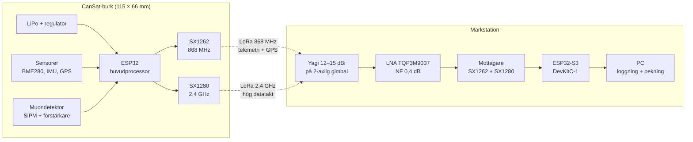
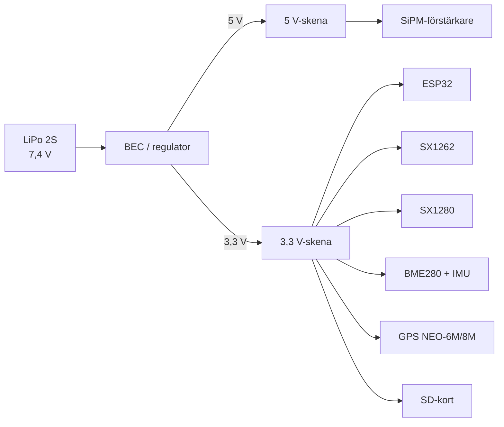
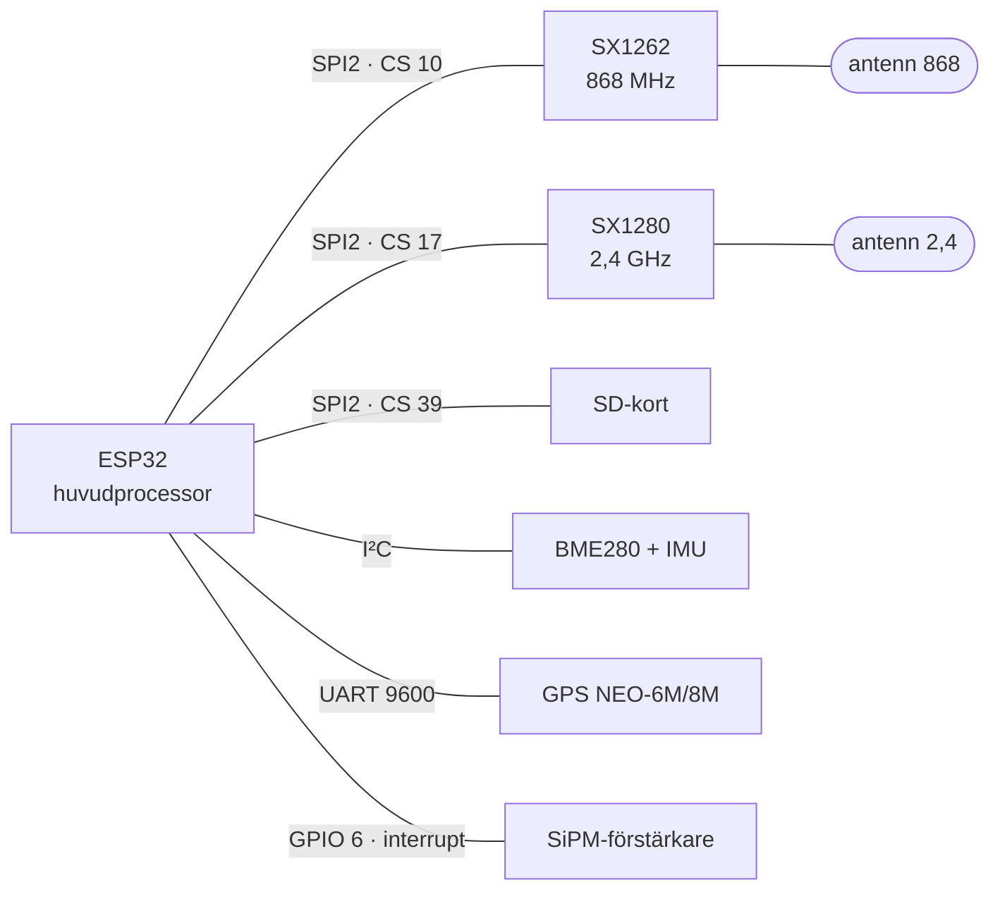
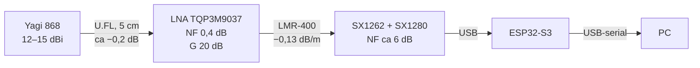
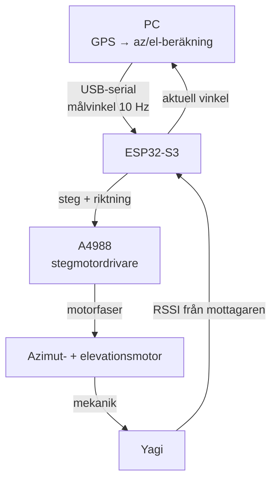
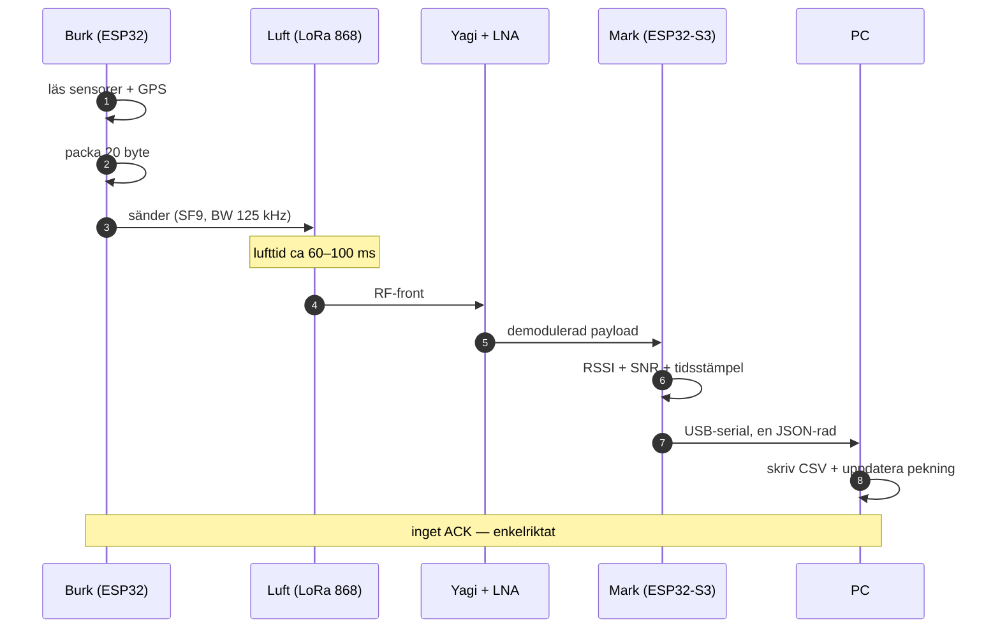

# Koppling — hur delarna kopplas ihop

Systemets **layout**, **bussar** och **kabeldragning**. Alla diagram är
[Mermaid](https://mermaid.js.org/) — de renderas inbyggt i både **Obsidian** och
**GitHub**, utan plugins.

> **Om pin-nummer:** tabellen i §7 är ett **förslag**, inte ett beslut. Verifiera mot
> ert faktiska kort innan ni löder. Se §8 för varför vissa pinnar är blockerade.

---

## 1. Systemöversikt — burk mot mark

**Läsning:** burken sänder, marken lyssnar. Ingen handskakning — nedlänken är
**enkelriktad broadcast**. Allt som är svårt (förstärkning, pekning, mekanik) sitter
på marken.

---

## 2. Burkens interna koppling

Två **separata** scheman: kraften är ett **träd**, signalerna är en **stjärna** kring
MCU:n. Att rita dem i samma graf blir oläsligt — det är därför de är delade.

### 2.1 Strömförsörjning — ett träd

### 2.2 Signalbussar — en stjärna kring MCU:n

Ledningar ritas **odirigerat** (`---`): en tråd har ingen riktning. Pilar används bara
där något faktiskt *flödar*, som i §4 och §5.

**Tre saker att lägga märke till:**

1. **SPI2 delas av tre enheter** (SX1262, SX1280, SD) med **separata CS-linjer**.
   Det är rätt — SPI är en buss, inte en punkt-till-punkt-länk. Kravet är att bara en
   CS är låg i taget, och att koden aldrig initierar SD-kortet samtidigt som radion.
2. **SiPM-pulsen går på GPIO-interrupt**, inte på ADC. Ni räknar pulser, ni mäter inte
   amplitud — en diskriminator + interrupträknare är snabbare och mer robust.
3. **Antennerna sitter så långt ifrån varandra som möjligt** inuti burken. 868-monopolen
   är 86 mm (λ/4), 2,4-monopolen 31 mm — de får inte ligga parallellt nära varandra.

---

## 3. Markstationens RF-kedja — var förlusterna sitter

### Varför LNA:n sitter vid antennen och inte vid mottagaren

Friis formel för kaskad brusfaktor:

$$
F_{\text{tot}} = F_1 + \frac{F_2 - 1}{G_1} + \frac{F_3 - 1}{G_1 G_2} + \dots
$$

Sätter man **koaxen före LNA:n** blir koaxens dämpning `F₁` — och den adderar direkt till
systembruset, utan att någon förstärkning kan kompensera den. Med `F_LNA = 1,096` (0,4 dB),
`G_LNA = 100` (20 dB), `F_RX = 3,98` (6 dB) och 10 m koax:

| Kabel (10 m @ 868 MHz) | Koax **före** LNA | LNA **före** koax | Vad man vinner |
|---|---|---|---|
| **LMR-400** (1,28 dB) | `F_tot = 1,51` → **1,80 dB** | `F_tot = 1,14` → **0,57 dB** | **1,2 dB** |
| **RG-58** (5,0 dB) | `F_tot = 3,56` → **5,51 dB** | `F_tot = 1,21` → **0,83 dB** | **4,7 dB** |

**Slutsats:** med bra kabel är flytten värd ~1,2 dB; med RG-58 är den värd ~4,7 dB.
Det är samma arbete — det är bara kabeln som avgör om det lönar sig.

> ⚠️ LNA:n behöver **matning via koaxen** (bias-T) eller en extra ledare, eftersom den
> sitter uppe på masten. Planera för det i kabeldragningen.

---

## 4. Gimbal-styrning — styrloopen

**Två reglerkretsar, inte en:**

| Krets | Sensor | Hastighet | Roll |
|---|---|---|---|
| **Grov** | GPS i telemetrin | 1–10 Hz | absolut pekning, ±1° |
| **Fin** | RSSI-peak | 10–50 Hz | korrigerar GPS-fel och multipeleffekter |

GPS:en ger **absolut** vinkel men har ~5 m fel; RSSI ger **relativ** maxima men är känslig
för reflektioner. Kör grovt på GPS, finjustera på RSSI. Se
[RADIOTEKNIK.md](RADIOTEKNIK.md) §7 om fast apertur vs fast gain — vid 2,4 GHz är
strålen bara 17,5° bred, så finjusteringen måste vara snabb.

---

## 5. Ett telemetripaket — vägen genom systemet

**Varför inget ACK:** ett kvitto kräver en returväg, och returvägen är den svaga länken
(burken har omni-antenn, marken har riktantenn). Att kvittera ett paket som *kom fram* är
onödigt; att kvittera ett paket som *inte* kom fram är omöjligt. Buffra i burken och skicka
sekvensnummer så att marken kan upptäcka luckor i efterhand.

---

## 6. Kabeldragning — praktiska val

| Sträcka | Kabel | @868 MHz | @2,4 GHz | Not |
|---|---|---|---|---|
| Antenn → LNA | U.FL, **< 5 cm** | ~0,2 dB | ~0,2 dB | håll kort — enda stället det spelar roll |
| LNA → mottagare | **LMR-400** | **0,13 dB/m** | 0,22 dB/m | 10 m = 1,3 dB ✅ |
| LNA → mottagare | RG-58 | 0,50 dB/m | 1,06 dB/m | 10 m = 5,0 dB ❌ **undvik** |
| Mottagare → PC | USB | — | — | håll < 3 m utan hub |

Källor: [LMR-400-datablad (Times Microwave)](https://timesmicrowave.com/wp-content/uploads/2022/06/lmr-400-datasheet-1.pdf)
— 12,8 dB/100 m @ 900 MHz, 22,2 dB/100 m @ 2,5 GHz.

**Tumregel:** varje dB förlust *före* LNA:n kostar en dB systembrus. Varje dB *efter*
LNA:n kostar nästan ingenting, eftersom LNA:ns 20 dB förstärkning redan har lyft signalen
över mottagarens brusgolv.

---

## 7. Pinout — förslag för ESP32-S3

> ⚠️ **Förslag, inte beslut.** Numren följer ESP32-S3:s IO-MUX-standard för SPI2. Verifiera
> mot ert kort och mot er faktiska modul. Gäller **ESP32-S3** — klassiska ESP32 har andra
> standardpinnar.

### SPI2 (delad buss — tre enheter)

| Signal | ESP32-S3 | Kopplas till |
|---|---|---|
| SCK | GPIO 12 | SX1262 SCK + SX1280 SCK + SD SCK |
| MOSI | GPIO 11 | SX1262 MOSI + SX1280 MOSI + SD MOSI |
| MISO | GPIO 13 | SX1262 MISO + SX1280 MISO + SD MISO |
| **CS_868** | GPIO 10 | SX1262 NSS |
| **CS_24** | GPIO 17 | SX1280 NSS |
| **CS_SD** | GPIO 39 | SD-modul CS |

### Radiostyrning

| Signal | ESP32-S3 | Kopplas till |
|---|---|---|
| BUSY_868 | GPIO 14 | SX1262 BUSY |
| DIO1_868 | GPIO 15 | SX1262 DIO1 |
| RST_868 | GPIO 16 | SX1262 NRESET |
| BUSY_24 | GPIO 18 | SX1280 BUSY |
| DIO1_24 | GPIO 21 | SX1280 DIO1 |
| RST_24 | GPIO 47 | SX1280 NRESET |

### Sensorer och övrigt

| Signal | ESP32-S3 | Kopplas till |
|---|---|---|
| SDA | GPIO 8 | BME280 (0x76) + IMU (0x68) |
| SCL | GPIO 9 | — |
| GPS_RX | GPIO 4 | GPS **TX** |
| GPS_TX | GPIO 5 | GPS **RX** |
| MUON_PULSE | GPIO 6 | diskriminatorutgång |
| VBAT_SENSE | GPIO 7 | spänningsdelare 2:1 |

**Korskoppling GPS:** MCU:ns **RX** ska till GPS:ens **TX**. Det är det vanligaste
löd-fel som finns — dubbelkolla det.

---

## 8. Varför just dessa pinnar

| Område | Status | Orsak |
|---|---|---|
| GPIO 0–21 | ✅ användbara | allmänna I/O (undantag nedan) |
| GPIO 0, 3, 45, 46 | ⚠️ | strapping-pinnar — påverkar boot-läget |
| GPIO 19, 20 | ❌ | USB D−/D+ |
| GPIO 26–32 | ❌ | kopplade till SPI-flash (WROOM-1) |
| GPIO 33–37 | ❌ | Octal PSRAM på N8R8/N16R8-moduler |
| GPIO 43, 44 | ❌ | UART0 — seriell konsol |
| GPIO 48 | ⚠️ | ofta RGB-LED på DevKitC-1 — kontrollera ert kort |
| GPIO 39, 47 | ✅ | fria, används i tabellen ovan |

---

## 9. Diagramkonventioner (för er som redigerar)

Alla diagram i det här repot är Mermaid. Följande regler gör att de renderas **lika** i
Obsidian och på GitHub:

| Regel | Varför |
|---|---|
| Använd `flowchart`, `sequenceDiagram`, `stateDiagram-v2`, `classDiagram`, `erDiagram`, `gantt`, `pie`, `gitGraph` | GitHub pinnar en Mermaid-version som saknar nyare typer |
| **Undvik** `block-beta`, `architecture-beta`, `sankey-beta`, `packet-beta`, `timeline`, `mindmap` | stöds inte (eller sent) på GitHub |
| Citera etiketter med specialtecken: `A["text (parentes)"]` | `(`, `)`, `:` och `,` kraschar parsern oskyddat |
| Inga `[[wikilänkar]]` i noder | Obsidian-specifikt — GitHub visar råtexten |
| Inga `click`-callbacks | GitHub kör dem inte (säkerhet) |
| Undvik `%%{init: ...}%%`-teman | GitHub och Obsidian renderar ändå olika teman |
| **ASCII-ID:n** på noder (`R868`, inte `R868MHz_ä`) | å/ä/ö i *ID:n* kan ge parsefel |
| **Å/ä/ö i etiketter går bra** | filerna är UTF-8 — men bara i etiketterna, inte i ID:na |
| ` ` för radbrytning — men håll etiketterna korta | fungerar i båda, men blir oläsligt på mobil |

### När Mermaid inte räcker

| Behov | Verktyg | Kommentar |
|---|---|---|
| Kretschema | **schemdraw** (Python) → `.svg` | committa både `.py` och `.svg` — då är bilden reproducerbar |
| Redigerbar ritning | **`.drawio.svg`** | XML inbäddad i SVG: redigerbar i draw.io, renderas som bild på GitHub |
| Frihandsskiss | Excalidraw | renderas **inte** på GitHub — håll dem utanför `dokument/` |
| Till PDF (PLR) | exportera Mermaid → PNG | Mermaid renderas inte i Word/PDF |

---

## Se även

- [KOMMUNIKATION.md](KOMMUNIKATION.md) — länkbudget och antennval
- [RADIOTEKNIK.md](RADIOTEKNIK.md) — varför LNA:n sitter där den sitter, fast apertur vs fast gain
- [GIMBAL.md](GIMBAL.md) — mekaniken bakom §4
- [MUONDETEKTOR.md](MUONDETEKTOR.md) — SiPM-kedjan bakom §2
- [PROTOKOLL.md](PROTOKOLL.md) — varför SX1262 + SX1280 och inte ett chip
