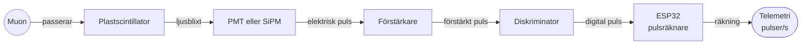

# Muondetektor — scintillator + PMT/SiPM

*Sekundärmission: räkna kosmisk muonstrålning under nedfärden och jämför 1 km med havsnivå.*

---

## Del 1 — Forskningsöversikt: fysik och konstruktion

*Sammanställd 2026-11-04. Aktuellt: i stället för diffusionskammare bygger vi en
**muon-detektor med plastscintillator + fotomultiplikator (PMT)** — en robust, mätbar
sekundärmission som kan räkna kosmisk muon-strålning under nedfärden. Det här dokumentet
kartlägger fysiken, 1 km-vs-havsnivå-skillnaderna och konstruktionen.*

---

### 1. Varför muondetektor i en CanSat? (motivering)

En muondetektor är ett **tydligt, mätbart och robust** alternativ till cloud chamber:
- **Räknar strålning** (antal muonträffar under ~70–120 s) istället för att kräva optiska
  spårbilder (som cloud chambern misslyckats med i flygning).
- Kan jämföra **räkenhastigheten vid 1 km vs marken** — ett rent, upprepbart
  "vetenskapsresultat" som passar poängkriterierna (vetenskapligt värde + teknik).
- Robust i 30 G, kyla och rotation — inga vätskor, ingen optik att rikta.

---

### 2. Fysiken — muoner i korthet

- Muoner är den **vanligaste laddade partikeln som når jordytan** från kosmisk strålning:
  ~1 muon/cm²/min vid havsnivå.
- De skapas högt upp (~15–26 km) när primärpartiklar kolliderar med atmosfären och
  bildar pioner/kaoner som sönderfaller → muon + neutrino[4][6].
- De överlever till marken tack vare **tidsdilatation** (γ≈39 för 4 GeV-muoner, livstid
  i rörelse förlängs långt över ~2,2 µs-vilan)[4][5].
- **Viktig poäng:** muon räknas/läcker strålning — de är elektriskt laddade och kan
  detekteras i en scintillator + PMT utan att bygga bilder.

#### Nyckelsiffror att citera till bedömare

| Storhet | Värde | Källa |
|---|---|---|
| Vertikal muonflux vid havsnivå | ~70 m⁻²s⁻¹sr⁻¹ (~1/cm²/min; integrerat ~127 m⁻²s⁻¹) | [1][2][5] |
| Medelenergi vid havsnivå | ~4 GeV | [4] |
| Ursprunglig muonenergi (före atmosfärisk förlust) | ~6 GeV | [4] |
| Energiförlust i luft | ~2 MeV per g/cm² | [4] |
| Atmosfärisk kolumn (vertikal) | ~1000 g/cm² (≈1030 hPa vid havsnivå) | [4] |

---

### 3. Hur muoner skiljer sig vid 1 km vs havsnivå

#### 3.1 Frekvens (flux) — HÖGRE vid 1 km

- Den vertikala fluxen vid havsnivå är ~70 m⁻²s⁻¹sr⁻¹.
- Vid **600 m höjd** är den uppmätt till **98,8 m⁻²s⁻¹sr⁻¹ → ~36 % högre** än havsnivå[1].
- Höjdberoendet för högenergi-muoner (p≥10 GeV) ges av Φ(h)=e^(h/L) med
  **L = 4900 + 750·p(GeV)**[2][3]. Vid h=1000 m och p=10 GeV → Φ(1 km) ≈ **1,08×** Φ(0).
- **Men ökningen är mycket större för lågenergi-muoner** (de flesta muoner en detektor
  ser): hela spektrat under ~100 GeV ökar mer markant med höjden[2][3][6].

**Praktiskt:** vid 1 km räknar detektorn **~25–40 % fler muoner** än vid havsnivå (mer
om man räknar lågenergi). På 70–120 s i toppen får man betydligt fler träffar att mäta.

#### 3.2 Energier — NÄSTAN SAMMA, men mjukare spektrum i toppen

- Muoner förlorar ~2 MeV/g/cm², totalt ~2 GeV genom atmosfären (~1000 g/cm²) → medel
  ~4 GeV vid marken[4].
- Vid **1 km är luftkolumnen ~11–13 % tunnare** (~900 hPa ≈ 880 g/cm² vs ~1030).
  Följder:
  - Muoner som når 1 km har passerat mindre luft → **förlorat ~0,3 GeV mindre** och har
    högre kvarvarande energi än vid marken för samma ursprungsenergi.
  - Fler lågenergi-muoner (ned till ~0–1 GeV) överlever till 1 km men stoppas i den sista
    km:atan → **jämfört med havsnivå finns relativt fler lågenergi-muoner uppe**.
- **Medelenergin hos detekterade muoner är i praktiken liknande (flera GeV)**, men det
  uppmätta spektrat vid 1 km lutar mot **fler lågenergi-händelser** än vid havsnivå.
  Energiparametern E₀ i fluxmodellen minskar med höjden[1].

#### 3.3 Konsekvens för detektorn

| Effekt | Vid 1 km jämfört med havsnivå |
|---|---|
| Räkenhastighet (flux) | **~25–40 % högre** (mest i lågenergi) |
| Energier hos träffar | liknande medel (~1–4 GeV), **fler lågenergi** |
| Detekterbarhet | enkelt — laddade partiklar lämnar energipulser lätt synliga |

**Slutsats:** samma detektor klarar både markmätning och 1 km-mätning. Man jämför helt
enkelt **räkenhastigheten per tid** (och ev. pulsstorlek som grov energiskattning), och
förväntar sig **fler träffar uppe** — ett snyggt, mätbart uppdrag.

---

### 4. Konstruktion: plastscintillator + PMT/SiPM

#### 4.1 Princip

När en muon passerar scintillatorn exciterar den molekyler som sedan sänder ut
**ljusblixtar (scintillation**lysch). Fotomultiplikatorn (PMT) eller kiselfotomultiplikatorn
(SiPM) omvandlar ljuset till en **elektrisk puls** — varje puls ≈ en muon.

#### 4.2 Komponentval

| Komponent | Typ | Not |
|---|---|---|
| **Scintillator** | plastscintillatorplatta (~1 cm tjock, polystyren-baserad) | Billig, robust, lätt; stort areaantal fås i 1–2 plattor |
| **Ljusdetektor** | PMT (fotomultiplikatorrör) *eller* **SiPM** (kisel-PMT) | SiPM billigare/tåligare för skola; PMT mer känsligt ljusutbyte |
| Förstärkare + diskriminator | enkel konditioneringskrets | Tröskel för att sortera bort brus |
| Räkne-IC/CPU | ESP32 (redan i burken) | räkna pulser och tidsstämpla |
| Ljusbarriär | svart tejp/hölje runt scintillator | PMT/SiPM är ljuskänsliga — fullständigt mörkt i burken |

#### 4.3 Massa/ström/plats (tumregel)

- Plastscintillatorplatta: ~20–60 g (beroende på storlek).
- SiPM + krets: ~10–20 g.
- Effektbehov: SMÅ — passiv detektering; bara förstärkare + räknare drar ~0,1–0,5 W.
- Ryms lätt i 115×66 mm med en nyckel: **ge scintillatorn maximal area uppifrån** så
  muoner passerar flest ytor.

> ⚠️ Återanvänd **inte** den gamla cloud-chamber-massan rakt av — räkna om mass/
> ström/plats-budgeten (se [arkiv/CLOUD-CHAMBER.md](../arkiv/CLOUD-CHAMBER.md)).

#### 4.4 Verifiering och "vetenskapligt" uppdrag

1. **Kalibrera på marken:** mät räkenhastigheten på marknivå i flera minuter → referensvärde.
2. **Under nedfärden:** räkna kontinuerligt och tidsstämpla (1 s-bin).
3. **Dataanalys:** jämför räkenhastighet per tid mot referensen → förväntat **fler träffar
   uppe (~30–40 %)**; sammanfatta med höjdkurvan (från trycksensorn).
4. **Resultat:** en kurva "muonräkning/m^2/s vs höjd" — mätbart och presenterbart inför
   bedömare och i PLR.

---

### 5. Nackdelar / att vara ärlig om

- **Ingen spårbild** (till skillnad från cloud chamber) — man får en **räkning**, inte en
  visuell träffbild. (Det är samtidigt styrkan: robust och kvantitativ.)
- **Kort mättid (~70–120 s)** ger marginella statistik — därför flera minuter på marken
  som kalibrering först.
- **Muoner ~1/cm²/min** är få — man behöver **stor scintillatoryta / lång mättid** för
  statistiskt meningsfulla siffror. Beräkna förväntad räkning med detektor-arean (se §6).
- **PMT kräver högspänning** (~viss hundra–1000 V). Enklast/säkrast för skola: **SiPM**
  (drivs på låg spänning) — välj SiPM i första hand.

---

### 6. Förväntad räkning (snabb statistisk räkning)

- Vertikal flux ~70–90 m⁻²s⁻¹sr⁻¹ ≈ ~1 muon/cm²/min integrerat nerifrån (~127 m⁻²s⁻¹).
- Detektor med effektiv area ~30 cm² (t.ex. 5×6 cm-platta) och hänsyn till acceptans
  (µ från alla zenithvinklar) ger ordningsmässigt:
  - **Marknivå:** ~30 cm² × ~1,2 träffar/m²min/cm² ... förenklat: några tiotal-till-hundra
    träffar per minut → klart uppmätbara på 2–5 min.
  - **Vid 1 km:** ~25–40 % fler → tydlig skillnad på samma mättid.

> Obs: siffrorna är uppskattningar; gör en egen link-­/träff-räkning med den exakta
> scintillatorarean och normalisera mot havsnivåvärdet (~1/cm²/min) i PLR.

---

### 7. Öppna frågor att lösa

1. **Storlek/area** på plastscintillatorn som ryms i 115×66 mm och ger bäst träffstatistik?
2. **PMT vs SiPM:** SiPM för enkelhet/skola, eller PMT för högre ljuskänslighet?
3. **Mörkläggning/lyska:** hur tätas scintillator+PMT för 100 % mörker utan att blockera
   lufttrycksmätning?
4. **Diskriminatortröskel:** hur skiljer vi muonpulser från bakgrundsbrus (elektronik,
   kärn/andra strålning)?
5. **Integration med radio:** räkna lokalt på ESP32 och sänd summering via
   ESP-NOW/LoRa-nedlänk (§7 i KOMMUNIKATION.md).

---

### 8. Källförteckning

1. [Wani, Sinha, Banerjee & Bari, "A measurement of integrated vertical flux intensity of cosmic-ray muons…" (2024) — I₀=72.5 (ha) → 98.8 m⁻²s⁻¹sr⁻¹ vid 600 m](https://inspirehep.net/files/525261c87ba131aa5c0c881e04d849b8)
2. [Hebbeker & Timmermans, "A Compilation of High Energy Atmospheric Muon Data at Sea Level" (arXiv:hep-ph/0102042) — altitudformel Φ(h)=e^(h/L), L=4900+750·p](https://arxiv.org/pdf/hep-ph/0102042)
3. [Cimmino, "Principles and Perspectives of Radiographic Imaging with Muons" (MDPI J. Imaging) — muonflöde vs altitud, fluxformel](https://www.mdpi.com/2313-433X/7/12/253)
4. [HyperPhysics, "Atmospheric Muons" — ~1/cm²/min, medelenergi 4 GeV, ~2 GeV förlust i atmosfären](http://hyperphysics.phy-astr.gsu.edu/hbase/Particles/muonatm.html)
5. [Univ. Washington, "Cosmic Ray Counting" — vertikal flux I_v=0.82×10⁻² cm⁻²s⁻¹sr⁻¹, integrerad ~1.27×10⁻² cm⁻²s⁻¹](http://courses.washington.edu/phys433/muon%5Fcounting/counting%5Ftelescope.pdf)
6. [Richter et al., "Energy and angular distributions of atmospheric muons at the Earth" (IJMPA 2018) — skapelse 10–15 km, energiparametrar, altitudökning](https://doi.org/10.1142/s0217751x18501750)

---

*Levande översikt. Fysiksiffrorna verifieras mot källorna; konstruktions-/massdetaljer
fylls på när komponenter och layout bestäms.*

---

## Del 2 — PMT vs SiPM: val av ljusdetektor

*Analys 2026-11-04, för valet av ljusdetektor i scintillator-muondetektorn
(se del 1 i denna fil). För en skol-Cansat blir slutsatsen: **SiPM
är det säkrare, enklare och billigare valet**; PMT bara om vi vill ha maximal
ljusinkänslighet/hastighet och accepterar högspänning + komplexitet.*

---

### Hur de fungerar (kort)

| | **PMT (fotomultiplikatorrör)** | **SiPM (silicon photomultiplier)** |
|---|---|---|
| Teknologi | Vakuumrör med fotokatod + dynodkedja (elektronmultiplikation) | Halvledarchip (array av av diod-pixlar/GiG) |
| Detekterar | ljus → fotoelektroner → ~10⁵–10⁷ gången multiplikation | ljus → fotoelektroner i varje pixel → multiplikation via lavinfotodiod (Geiger) |
| Drivspänning | **högspänning ~300–1500 V** | **lågspänning ~25–60 V** |
| Typisk gain | ~10⁵–10⁷ | ~10⁵–10⁶ (per pixel) |

---

### Jämförelsetabell

| Kriterium | **PMT** | **SiPM** | Vinnare (för oss) |
|---|---|---|---|
| **Känslighet / ljusutbyte** | Utmärkt, stor katod, mycket känslig | Bra, hög PDE (~40–50 %) | PMT (marginellt) |
| **Tid och övervåtstyp** | Snabb respons ned till ~ns | Mycket snabb (sub-ns–ns) | SiPM |
| **Drivspänning** | **300–1500 V** — behöver DC-DC/omvandlare, högspänning i burken | **~25–60 V** — enkel lågspänningskrets | **SiPM** ✅ |
| **Säkerhet i CanSat (30 G, kyla, vibration)** | Vakuumrör som kan skadas/blippar vid stöt och skak | Solid-state, inga rörliga/vakuumdelar — robust | **SiPM** ✅ |
| **Storlek / vikt / plats i 115×66 mm** | Runt/monolit + sockel, känsligare för montering | Liten SMD/diode på kort — minimal plats/massa | **SiPM** ✅ |
| **Pris** | ~50–150 €+ (vakuumrör) | **~10–50 €** (modul) | **SiPM** ✅ |
| **Mörker/brus** | Lågt mörkerbrus efter uppvärmning; känslig för upphöjd ström | Mörker-/överstegsbrus (dark count) signifikant, ökar lite med kyla (positivt för oss i kallburk) | PMT (marginellt) |
| **Strömförbrukning** | Högspänningsomvandlare förbrukar | mycket lägre | **SiPM** ✅ |
| **Emballage/mörkläggning** | Kräver mörkt och skärmat | Kräver mörkt (men lättare hantering) | SiPM |
| **Enkelhet för skola** | **högspänning, förstärkning, regler** svåra | **plug-and-play-modul** | **SiPM** ✅ |

---

### Vanliga problem att planera för

#### Med PMT
- **Högspänning (300–1500 V):** krävs DC-DC-omvandlare. Ökar komplexitet, kostnad,
  och är en säkerhetsfråga i en fallande burk (30 G, kyla, isolering).
- **Robusthet:** vakuumrör kan bryta/ge instabil gain vid stöt och vibration.
- **Gain-drift:** känslig för temperatur; kalibrering svårare.

#### Med SiPM
- **Dark count (mörkerbrus):** SiPM ger små falska pulser även utan ljus. Lösning:
  sätt **diskriminatortröskel** och/eller volt-tid-tröskel så att bara större
  scintillationspulser räknas. (Kyla i burken sänker dark count — en fördel i mars/Vasa.)
- **Energiseparation:** små muonpulser vs brus — behöver krets/firmware för att sortera.
- **Fem-tals-pixell: cross-talk** kan ge dubblering — normalt försumbart vid räkning.

---

### Rekommendation för vår CanSat

**Välj SiPM.** Skälen i ordning:
1. **Enkelhet/säkerhet:** lågspänning + solid-state = lagom komplexitet för ett skollag
   och tål 30 G, kyla, vibration.
2. **Plats–/vikt–/pris:** liten, lätt (~10–20 g), ~10–50 € — passar 115×66 mm och 500 €-taket.
3. **Räkna lämpligt:** för vårt mål (räkna muoner, inte mäta energi exakt) räcker SiPM:s
   prestanda mer än väl; dess snabbhet och lågspänning är avgörande.
4. **Kyla hjälper:** burken i mars är kall → lägre dark count.

**Välj PMT bara om** vi vill göra en avancerad `energimätning` (pulshöjd = partikele energi)
med max ljuskänslighet och accepterar högspänning + förstärkningsreglering. För ett
"räkna muoner"-uppdrag är det överdimensionerat och nyttan liten.

> Om ni ändå vill åt mer ljus/målförmåga utan PMT-komplexitet: en **större SiPM-modul**
> eller **flera SiPM:er** kopplade i serie per scintillatoryta ger mer area till låg
> spänning/robusthet.

---

### Konkret projektval (förslag)

| Post | Val | Motivering |
|---|---|---|
| Ljusdetektor | **SiPM-modul** (t.ex. ~10 mm), med förstärkare/diskriminator-på-kort | enkel, säker, billig |
| Scintillator | plastscintillator ~1 cm tjock | billig, robust, klarar G |
| Tröskel/brus | diskriminatortröskel i krets + firmware | tar bort dark count |
| Data | räkna pulser på ESP32 + tidsstämpel, sänd via ESP-NOW/LoRa | integrerat med §7 |
| Test | kalibrera på marken (flera min) → mät räkning/area vs havsnivå | får referensvärde och förväntat 1 km-avvik |

---

### Beslutsunderlag för bedömare (kort punch-line)

> "Vi valde **SiPM** framför PMT därför att det ger tillräcklig känslighet och snabbhet för
> att räkna muoner, men kräver **lågspänning, är solid-state/robust i 30 G och kyla**, och
> blir både **mindre, lättare och billigare** än en PMT — avgörande i en 115×66 mm-burk med
> ≤500 €-budget. PMT:n gav bara marginellt högre ljuskänslighet, vilket vi inte behöver för
> ett räkneuppdrag."

---

*Se även del 1 i denna fil §4 (konstruktion) och
del 1 i denna fil för hur ni svarar på kritik.*

---

## Se även

- [CANSAT-GRUND.md](CANSAT-GRUND.md) — ramarna: massa, volym, 30 G, mättid
- [KOMMUNIKATION.md](KOMMUNIKATION.md) — nedlänken som skickar räknedatan
- [KOSTNADER.md](KOSTNADER.md) — sekundärmissionens budgetpost
- [arkiv/CLOUD-CHAMBER.md](../arkiv/CLOUD-CHAMBER.md) — det övergivna alternativet
